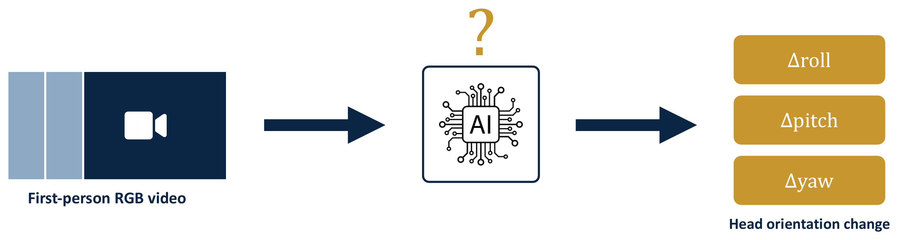
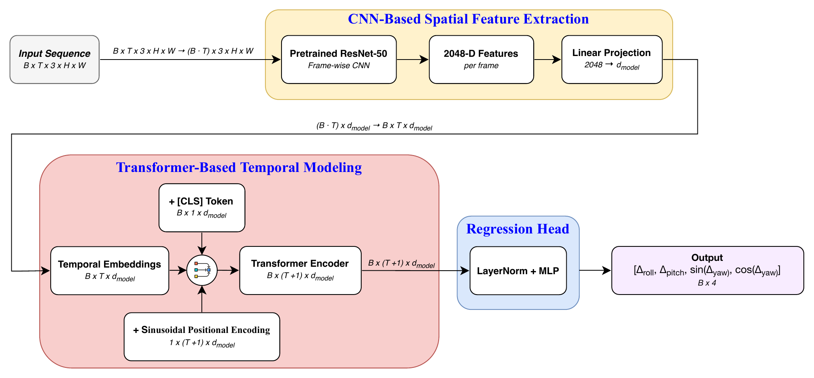

# Head Orientation Change Estimation from First-Person RGB Video

Code accompanying the MSc thesis **"Deep Learning-Based Head Orientation Change Estimation from First-Person RGB Video Data"**.

| | |
|---|---|
| **Author** | Ioannis Panagiotopoulos |
| **Programme** | MSc in Geoinformatics, National Technical University of Athens (NTUA) |
| **Conducted at** | TU Wien, Erasmus+ mobility programme |
| **Supervisor** | Prof. Anastasios Doulamis (NTUA) |
| **Research advisors** | Prof. Ioannis Giannopoulos (TU Wien), Dr. Markus Kattenbeck (TU Wien) |
| **Year** | 2026 |
| **Thesis** | *Link to the NTUA DSpace record will be added after publication.* |

---

## Overview

Mobile eye-tracking glasses record first-person video. Head orientation, however, usually requires an Inertial Measurement Unit (IMU), and older recordings may not have IMU data. This project investigates how accurately **head-orientation changes**, meaning the change in roll, pitch and yaw between consecutive frames (≈33 ms apart), can be estimated **from the scene-camera video alone**.

- **Input:** a short sequence of first-person RGB frames.
- **Output:** the relative orientation change at the current frame: Δroll, Δpitch, and sin/cos of Δyaw.
- **Ground truth:** IMU measurements, used only to build the training targets and never as model input. Roll and pitch come from the eye tracker's internal IMU; yaw comes from an external Xsens MTi-300.

<p align="center">
  
</p>

## Method in brief

1. **Preprocessing (ET-Head Mounted dataset).**
   - Exports the scene-camera frames.
   - Synchronizes the eye-tracker IMU and the external head IMU using recording-specific clock offsets.
   - Pairs every video frame with its orientation angles. Labels are built either from the nearest IMU sample or from a temporal window mean.
   - Crops the frames to a square and resizes them to 512×512.
2. **Model.**
   - A ResNet-50 (ImageNet-pretrained) extracts per-frame features.
   - A Transformer encoder with a CLS token and sinusoidal positional encoding models the temporal sequence.
   - A small regression head predicts the four target values.
3. **Experiments.**
   - Sequential one-factor-at-a-time refinement on a participant-level subset of 9/2/2 recordings: loss function, IMU-angle aggregation, temporal context, batch size, learning rate, regularization, and Transformer capacity.
   - The final configuration was then retrained on the full participant-level split of 26/6/6 recordings.

### Model architecture



*CNN–Transformer architecture (thesis Figure 5). The IMU is used only to build the training targets and is never a model input.*

### Final configuration

| Setting | Value |
|---|---|
| Loss | Smooth L1 (β = 0.1) |
| IMU-angle aggregation | Window 31 |
| Temporal context | 40 past + 1 current + 5 future frames (stride 8) |
| Batch size | 12 |
| Base learning rate | 1×10⁻⁴ (AdamW, backbone at 0.1×, cosine annealing) |
| Dropout / weight decay / gradient clipping | 0.2 / 0 / 1.0 |
| Transformer | d_model 64, 2 layers, 4 heads, FFN 512 |
| Input resolution | 512 × 512 |

## Results

Dataset: 38 recordings from 27 participants (urban walking, Vienna), with a participant-level split.

| Evaluation set | RMSE Roll | RMSE Pitch | RMSE Yaw | **Mean RMSE** | Mean MAE | Mean MedAE | No-change Mean RMSE |
|---|---|---|---|---|---|---|---|
| Validation | 0.926° | 0.905° | 0.574° | **0.802°** | 0.391° | 0.172° | 0.884° |
| Test (unseen participants) | 0.868° | 0.897° | 0.740° | **0.835°** | 0.381° | 0.165° | 0.854° |

The *no-change* reference assumes zero head motion between consecutive frames. The final model reduces Mean RMSE by **9.3 %** (validation) and **2.2 %** (test) relative to this reference. Per-run training histories of all experiments are provided in [`results/`](results/).

## Repository structure

```
├── preprocessing/
│   ├── et_head_mounted/   # Preprocessing of the dataset used in the thesis (steps 00–10)
│   └── et_upper_body/     # Preprocessing of the second dataset (explored, not used for the final model)
├── training/              # Model, datasets, splits, and the original experiment scripts
│   └── experiments/       # One folder per experiment (Sections 5.2–5.9 of the thesis)
├── analysis/              # Target-distribution analysis and appendix figures
├── results/               # Training histories and metrics of every run (no model weights)
└── docs/                  # Reproducibility notes, data availability, figures of the READMEs
```

Each top-level folder has its own README with details.

## Provenance of the code

The **executable code is the code that was run** for the thesis; it has not been refactored. For readability, scripts were renamed and their docstrings and comments were rewritten in English. An automated comparison of the code before and after (Python AST, PowerShell non-comment lines) confirms that the executable code did not change, apart from a few documented corrections. The first commit of each folder keeps the original files. See the change notes in [`preprocessing/README.md`](preprocessing/README.md#changes-since-the-original-upload) and [`training/README.md`](training/README.md#changes-since-the-original-files).

- **Preprocessing** ran on a Windows workstation at TU Wien. The scripts contain the original local paths.
- **Frame resizing, training, and evaluation** ran on the TU Wien **dataLAB** cluster (SLURM, NVIDIA A100). The original SLURM launch scripts are included.

The scripts contain the hard-coded paths of the original machines. [`docs/reproducibility.md`](docs/reproducibility.md) explains how to run them elsewhere and what can and cannot be reproduced exactly (e.g., GPU non-determinism).

## Installation

The environment is managed with [uv](https://docs.astral.sh/uv/) and uses Python 3.11 (`.python-version`). `pyproject.toml` and `uv.lock` define one dependency group for the preprocessing and one for the training, evaluation and analysis:

```bash
uv sync --group training        # training, evaluation and analysis (PyTorch 2.5.1, torchvision 0.20.1)
uv sync --group preprocessing   # preprocessing (pandas, pyarrow, OpenCV)
uv sync --all-groups            # both
source .venv/bin/activate
```

Alternatively, the `Dockerfile` provides the environment of the training, evaluation and analysis code, with CUDA support; see [`docs/reproducibility.md`](docs/reproducibility.md#docker).

The environment is a reconstruction; see [`docs/reproducibility.md`](docs/reproducibility.md#environment). Without the data, the appendix figures can be redrawn from [`results/`](results/) as described in [`analysis/README.md`](analysis/README.md#appendix-figures).

## Data availability

The recordings are first-person videos of public urban spaces and may show bystanders who can be identified. For privacy and data-protection reasons, the data are **not publicly available**. The recordings belong to the [Spatial Human-Computer Interaction Lab](https://geoinfo.geo.tuwien.ac.at/spatial-hci-lab/) of the Research Group Geoinformation at TU Wien, which collected them. The author does not hold a copy and cannot share them; requests for access should be directed to the lab.

No raw or derived data are included in this repository. [`docs/data_availability.md`](docs/data_availability.md) describes the folder layout the code expects, so the scripts can be read and followed without the data.

## Pretrained model

The weights of the final model are provided as an asset of the GitHub Release [v1.0.0](https://github.com/IoannisPan11/egocentric-head-orientation-estimation/releases/tag/v1.0.0):

- File: [`best_model.pth`](https://github.com/IoannisPan11/egocentric-head-orientation-estimation/releases/download/v1.0.0/best_model.pth) (275 MB), the checkpoint of the best epoch (5) of `train_final_checkpoint.py`
- SHA-256: `8e7d0b0d7b55ffbb2305a9de5e12413c699bc64de3a9b66227ce5468e46928fe`
- Contents: `model_state_dict`, `optimizer_state_dict`, `epoch` and `best_val_loss`

The model is loaded from the `training/` folder, with this folder on the Python path:

```python
import torch
from model_resnet_transformer import ResNetTransformerRegressor

model = ResNetTransformerRegressor(d_model=64, nhead=4, num_layers=2, dim_feedforward=512,
                                   dropout=0.2, pretrained_backbone=False, use_cls=True, out_dim=4)
checkpoint = torch.load("best_model.pth", map_location="cpu", weights_only=True)
model.load_state_dict(checkpoint["model_state_dict"])
model.eval()

with torch.no_grad():
    out = model(frames)  # frames: (batch, 46, 3, 512, 512)
d_roll, d_pitch = out[:, 0] * 180, out[:, 1] * 180
d_yaw = torch.rad2deg(torch.atan2(out[:, 2], out[:, 3]))
```

The input is a window of 46 consecutive 512 × 512 RGB frames (40 past frames, the current frame and 5 future frames), scaled to [0, 1] and normalised with the ImageNet mean and standard deviation, as in `train_final_checkpoint.py`. The output is the change in roll, pitch and yaw, in degrees, between the last past frame and the current frame.

## Citation

If you use this code, please cite the thesis:

> Panagiotopoulos, I. (2026). *Deep Learning-Based Head Orientation Change Estimation from First-Person RGB Video Data* [Master's thesis, National Technical University of Athens].

```bibtex
@mastersthesis{panagiotopoulos2026head,
  author = {Panagiotopoulos, Ioannis},
  title  = {Deep Learning-Based Head Orientation Change Estimation from First-Person RGB Video Data},
  school = {National Technical University of Athens},
  year   = {2026}
}
```

The same information is in [`CITATION.cff`](CITATION.cff). The link to the thesis will be added after publication.

## License

The code is released under the MIT License (see [`LICENSE`](LICENSE)). This license covers the code only; it does not grant any rights to the underlying data.

## Acknowledgments

I would like to thank my supervisor, Prof. Anastasios Doulamis (NTUA), for the supervision and support throughout this thesis. I am also grateful to Prof. Ioannis Giannopoulos and Dr. Markus Kattenbeck (TU Wien), who proposed the research topic, provided the data, and offered scientific guidance during my Erasmus+ stay at TU Wien. Computational resources were provided by TU Wien: a workstation of the Spatial Human-Computer Interaction Lab for the preprocessing, and the dataLAB GPU cluster for the training and evaluation.
