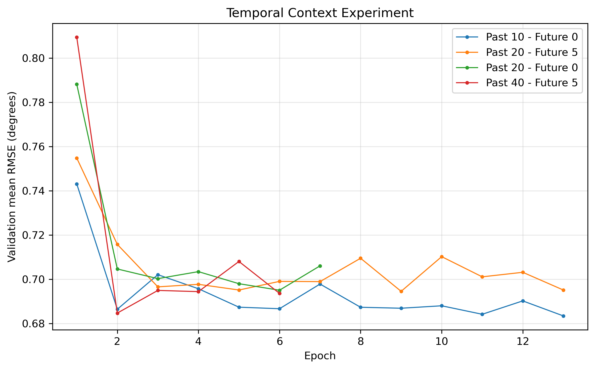

# Analysis

This folder contains two scripts that are not part of training: the analysis of the prediction targets with the no-change reference, and the figures of Appendix A of the thesis.

| File | Purpose | Thesis |
|---|---|---|
| `analyze_target_distribution.py` | Statistics of the frame-to-frame orientation changes, and the error of the no-change reference that assumes zero head motion | Table 4, Table 7 |
| `run_target_distribution.sh` | Launcher of the script above on the dataLAB cluster | |
| `generate_appendix_rmse_plots.py` | Validation Mean RMSE per epoch of all configurations of each experiment | Figures A.1–A.12 |
| `appendix_figures/` | The twelve figures as used in the thesis | Appendix A |

## Target distribution and no-change reference

`analyze_target_distribution.py` builds the windows of the baseline configuration (nearest-neighbour angles, 20 past + 1 + 5 future frames, stride 8), as in the training scripts. For every window it takes the change in roll, pitch and yaw between the previous and the current frame. For each angle it prints the mean and median absolute change, the standard deviation, the maximum and the RMSE of predicting zero change.

It does this for the whole dataset and for every subset of the preliminary and the final split. The thesis uses:

- **Table 4:** mean absolute change and standard deviation of the preliminary subset and of the whole dataset, to show that the subset is representative.
- **Table 7:** no-change Mean RMSE of the preliminary validation set (0.845°), the final validation set (0.884°) and the final test set (0.854°). These values are the fixed references of Chapter 5 and of [`results/`](../results/).

The script reads `fixed_split.json` and `final_split.json` by their file names, so it runs from the `training/` folder, where these files are:

```bash
cd training
python ../analysis/analyze_target_distribution.py
```

It needs the paired CSV files of preprocessing step 09 under the original data path on the cluster. The data are not public (see the main [README](../README.md#data-availability)).

## Appendix figures

`generate_appendix_rmse_plots.py` reads the `history.csv` of every run from `runs/<run folder>/`, the output folder of the training scripts, and draws one figure per experiment into `appendix_figures/`. Each figure contains the same configurations as the corresponding table of Chapter 5, including the reference run of the previous step.

<p align="center">
  
</p>

*Figure A.3: validation Mean RMSE per epoch of the temporal-context experiment.*

The script runs from the folder that contains `runs/`. After new training runs, this is the `training/` folder:

```bash
cd training
python ../analysis/generate_appendix_rmse_plots.py
```

To draw the figures from the histories in [`results/`](../results/), copy the run folders into a `runs/` folder first. From the repository root:

```bash
mkdir -p figures_rebuild/runs
cp -R results/*/* figures_rebuild/runs/
cd figures_rebuild
python ../analysis/generate_appendix_rmse_plots.py
```

The figures are written to `figures_rebuild/appendix_figures/`. The folder `figures_rebuild/` is ignored by git.

## Changes since the original files

- Docstrings were added to both Python scripts.
- `generate_appendix_rmse_plots.py` reads three runs under their current names (`Temporal_Context_Sweep__Past10_Future0`, `Temporal_Context_Sweep__Past20_Future0`, `Batch_Size_Sweep__Batch12`; see [`results/README.md`](../results/README.md#changes-since-the-original-files)). Apart from these five paths, the executable code is unchanged, which was verified by comparing the abstract syntax tree (AST) before and after.
- Jupyter backup copies of the figures were not included.
