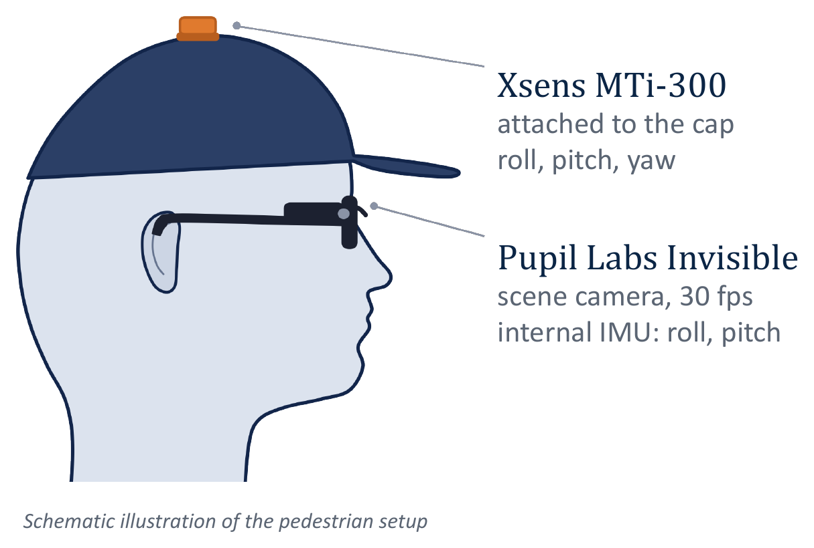
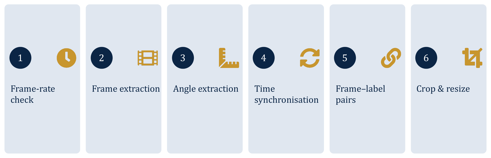

# Preprocessing

This folder turns the raw eye-tracking recordings into **frame–label pairs**: every scene-camera frame is paired with its roll, pitch and yaw. Thesis reference: Chapter 3.

Two datasets were preprocessed. **Only ET – Head Mounted was used to train and evaluate the model.**

| Folder | Dataset | Setup | Used for the model |
|---|---|---|---|
| [`et_head_mounted/`](et_head_mounted/) | **ET – Head Mounted** (pedestrians) | Pupil Labs Invisible glasses + Xsens MTi-300 IMU on a cap | Yes |
| [`et_upper_body/`](et_upper_body/) | **ET – Upper Body** (cyclists) | Pupil Labs Invisible glasses + Xsens Awinda (11 upper-body sensors) | No (excluded) |

## Why ET – Upper Body was excluded

Thesis Section 3.2.7 gives three reasons:

1. **Synchronization (main reason).** The IMU orientation angles could not be reliably aligned with the video timestamps, so the frame–label pairs were not trustworthy. The same synchronization method worked for ET – Head Mounted.
2. **Different frame rate:** 20 fps instead of 30 fps.
3. **Gait compensation.** The upper-body IMUs apply it; the eye-tracker IMU and the head-mounted IMU do not.

The scripts are still published for transparency. They document the work that was done and could be a starting point for future work.

## ET – Head Mounted pipeline

This is the dataset used for the final model. The illustration below shows its recording setup.

  

*Roll and pitch come from the internal IMU of the glasses, and yaw comes from the Xsens MTi-300 on the cap.*

The scripts run in numerical order. Each script starts with a docstring that describes its inputs, outputs and logic. The last column maps every script to one of the six steps above.

| Step | Script | What it does | Thesis step |
|---|---|---|---|
| 00 | `00_extract_frames.ps1` | Exports every frame of the scene-camera video as PNG using FFmpeg | Frame extraction |
| 01 | `01_compute_sync_offsets.py` | Computes the per-recording clock offset from a manually read on-screen clock | Time synchronization |
| 02 | `02_check_frame_rate.py` | Checks the effective video frame rate in sliding 1-second windows | Frame-rate check |
| 03 | `03_convert_xsens_txt_to_parquet.py` | Converts raw Xsens text exports into Parquet part files | Angle extraction |
| 04 | `04_merge_parquet_parts.py` | Merges the Parquet parts into one file per recording | Angle extraction |
| 05 | `05_fix_xsens_timestamps.py` | Ensures each merged file has a usable time axis | Time synchronization |
| 06 | `06_sync_head_imu_to_eye_tracker.py` | Shifts the head-IMU timestamps onto the eye-tracker timeline using the offsets | Time synchronization |
| 07 | `07_add_epoch_timestamps.py` | Converts the synchronized head-IMU time to epoch timestamps | Time synchronization |
| 08 | `08_drop_incomplete_rows.py` | Removes rows with missing angles or timestamps | Time synchronization |
| 09 | `09_pair_frames_with_imus.py` | Pairs every frame with roll/pitch (eye-tracker IMU) and yaw (Xsens), using the nearest sample or a window mean | Frame–label pairs |
| 09b | `09b_pair_frames_with_imus_recording_032.py` | The same pairing for recording 032, whose folder layout differs from the others | Frame–label pairs |
| 10 | `10_crop_and_resize_frames.py` + `.sh` | Center-crops the labeled frames to a square and resizes them to 512×512 (1088×1080 → 1080×1080 → 512×512) | Crop and resize |

> **Step 10 ran on a different machine.** Steps 00–09 ran on the Windows workstation. Step 10 ran on the TU Wien dataLAB cluster as a SLURM job (`sbatch 10_crop_and_resize_frames.sh`), after the frames and the `paired_frames.csv` files had been uploaded there, and its output is what the training code reads.

Step 09 was run with `--half_window` 5, 10 and 15, and its outputs were saved as `paired_frames11.csv`, `paired_frames21.csv` and `paired_frames31.csv`. These are the label files of the Window 11, 21 and 31 runs; their nearest-sample columns are the same in all three files (see [`docs/data_availability.md`](../docs/data_availability.md#derived-data-input-of-the-training)).

Other folders in `et_head_mounted/`:

- `diagnostics/check_label_differences.py`: prints the typical frame-to-frame change of the labels in one recording. It is a quick check, not a pipeline step.
- `outputs/`: the frame-rate summaries written by step 02.

## ET – Upper Body scripts

These scripts follow the same steps, adapted to the Awinda data and to the per-participant "legs" of this dataset.

| Step | Script | What it does | Thesis step |
|---|---|---|---|
| 00 | `00_export_recordings_leg0.ps1` | Exports the leg0 recordings with pl-rec-export, working on copies | Frame extraction |
| 01 | `01_extract_frames_leg0.py` | Extracts the leg0 frames as JPEG | Frame extraction |
| 02 | `02_check_frame_rate_leg0.py` | Checks frame rate and timing gaps of the leg0 recordings | Frame-rate check |
| 03 | `03_extract_frames.py` | Extracts the frames of the other recordings as JPEG | Frame extraction |
| 04 | `04_check_frame_rate.py` | Checks the frame rate of every recording | Frame-rate check |
| 05 | `05_compute_sync_offsets.py` | Computes the per-participant clock offset | Time synchronization |
| 06 | `06_apply_offsets_to_upper_body_imu.py` | Applies the offsets to the upper-body IMU files | Time synchronization |
| 07 | `07_compute_angles_from_quaternions.py` | Computes roll, pitch and yaw from the head-sensor quaternions | Angle extraction |
| 08 | `08_pair_frames_with_imus.py` | Pairs every frame with the eye-tracker and upper-body IMU angles | Frame–label pairs |

`diagnostics/` contains the scripts written while investigating the synchronization problem that led to the exclusion of this dataset:

| Script | What it checks |
|---|---|
| `play_video_with_angles.py` | Plays a video next to the synchronized angles, to check the alignment visually |
| `inspect_imu_columns.py` | Prints the column structure of one upper-body IMU file |
| `check_imu_video_overlap_p112_leg4.py` | Start times and overlap of the IMU and video recordings of one participant |
| `report_first_timestamps.py` | First timestamp of the frames, eye-tracker IMU and upper-body IMU for every session |
| `find_closest_frames_to_imu_start.py` | The video frame closest to the first sample of each synchronized IMU file |
| `closest_frames_report.csv` | The same closest-frame check in CSV form, written by a variant of the script above that is not included |

`outputs/` contains the frame-rate summary written by step 04.

Notes on naming:

- **leg0.** The code and folders use "leg0" for the recording called "video0 (leg1)" in the thesis.
- **Neon.** The recordings come from Pupil Labs Invisible glasses. pl-rec-export expects the Neon-style file names `Neon Scene Camera v1 ps1.mp4/.time`, so step 00 renames the Invisible video files accordingly. This is the only reason the word "Neon" appears in the code.

## Running environment

The preprocessing (steps 00–09) ran on a **Windows workstation at TU Wien** with Python, pandas/pyarrow, OpenCV and FFmpeg. The Python packages can be installed with `uv sync --group preprocessing` (see the main [README](../README.md)); FFmpeg and PowerShell are needed for the `.ps1` scripts. The scripts contain the original absolute Windows paths (`E:\…`, `D:\…`), and some scripts also accept them as command-line arguments (`--root`, `--head_root`, …). The data are not public (see the main [README](../README.md#data-availability)).

## Changes since the original upload

The scripts were first uploaded exactly as they were run (commit [`6a4b6f2`](https://github.com/IoannisPan11/egocentric-head-orientation-estimation/commit/6a4b6f2)). They were then reorganized for readability:

- files renamed (table below) and moved into `diagnostics/` and `outputs/`;
- docstrings rewritten or added so that they match the file names, and Greek comments translated to English;
- two files removed: `nothing important.py` (an ad-hoc column printout) and the upper-body `06_fill_offsets_master_upper_body.py`, which was identical to step 05 except for the name of its output file.

**The executable code was not changed.** For every Python script this was verified by comparing the abstract syntax tree (AST) before and after, with docstrings excluded; for the PowerShell scripts, by comparing all non-comment lines. There are two exceptions. The SLURM script of step 10 now calls the Python file by its new name. In step 06 of ET – Upper Body, the first upload contained a test variant that subtracted the offset; it now adds it, as in ET – Head Mounted and in the thesis (Eq. 4–5). This dataset was not used for the model, so no reported result is affected.

Original file names

| Original name | New location |
|---|---|
| `head_mounted/00_export_world_frames_safe.ps1` | `et_head_mounted/00_extract_frames.ps1` |
| `head_mounted/01_fill_offsets_master.py` | `et_head_mounted/01_compute_sync_offsets.py` |
| `head_mounted/02_sanity_check.py` | `et_head_mounted/02_check_frame_rate.py` |
| `head_mounted/03_txt_ahs_on_to_parts_all.py.py` | `et_head_mounted/03_convert_xsens_txt_to_parquet.py` |
| `head_mounted/04_merge_all_parts_to_merged_parquet.py` | `et_head_mounted/04_merge_parquet_parts.py` |
| `head_mounted/05_fix_ts_ns_best_all.py` | `et_head_mounted/05_fix_xsens_timestamps.py` |
| `head_mounted/06_sync_head_imu_to_et_with_offsets.py` | `et_head_mounted/06_sync_head_imu_to_eye_tracker.py` |
| `head_mounted/07_add_head_epoch_all.py` | `et_head_mounted/07_add_epoch_timestamps.py` |
| `head_mounted/08_clean_head_epoch_csvs.py` | `et_head_mounted/08_drop_incomplete_rows.py` |
| `head_mounted/09_pair_frames_with_imus.py` | `et_head_mounted/09_pair_frames_with_imus.py` |
| `head_mounted/09_pair_single_032_window.py` | `et_head_mounted/09b_pair_frames_with_imus_recording_032.py` |
| `resize_head_mounted.py` / `.sh` (from the training code, not in the first upload) | `et_head_mounted/10_crop_and_resize_frames.py` / `.sh` |
| `upper_body/check_allinone_alignment.py` | `et_head_mounted/diagnostics/check_label_differences.py` |
| `head_mounted/fps_sanity_check_summary_*.csv` | `et_head_mounted/outputs/` |
| `upper_body/00_export_pl_rec_for_leg0.ps1` | `et_upper_body/00_export_recordings_leg0.ps1` |
| `upper_body/01_extract_world_frames_upper_body_leg0.py` | `et_upper_body/01_extract_frames_leg0.py` |
| `upper_body/02_sanity_check_fps_leg0.py` | `et_upper_body/02_check_frame_rate_leg0.py` |
| `upper_body/03_extract_world_frames_with_logging.py` | `et_upper_body/03_extract_frames.py` |
| `upper_body/04_world_fps_sanity_check_sliding.py` | `et_upper_body/04_check_frame_rate.py` |
| `upper_body/05_create_offsets_master_upper_csv.py` | `et_upper_body/05_compute_sync_offsets.py` |
| `upper_body/07_apply_offset_to_allinone.py` | `et_upper_body/06_apply_offsets_to_upper_body_imu.py` |
| `upper_body/08_compute_rpy_from_quat.py` | `et_upper_body/07_compute_angles_from_quaternions.py` |
| `upper_body/pair_creation.py` | `et_upper_body/08_pair_frames_with_imus.py` |
| `upper_body/09_mini-player_check_angles_calculation.py` | `et_upper_body/diagnostics/play_video_with_angles.py` |
| `upper_body/check_columns_of_initial_leg_k_allInOne.py` | `et_upper_body/diagnostics/inspect_imu_columns.py` |
| `upper_body/minicheck_for_potential_error_p122_leg4.py` | `et_upper_body/diagnostics/check_imu_video_overlap_p112_leg4.py` |
| `upper_body/final.py` | `et_upper_body/diagnostics/report_first_timestamps.py` |
| `upper_body/kontinoteroframecheck.py` | `et_upper_body/diagnostics/find_closest_frames_to_imu_start.py` |
| `upper_body/closest_frames_report.csv` | `et_upper_body/diagnostics/closest_frames_report.csv` |
| `upper_body/fps_sanity_check_summary_sliding_1s.csv` | `et_upper_body/outputs/fps_sanity_check_summary_sliding_1s.csv` |

