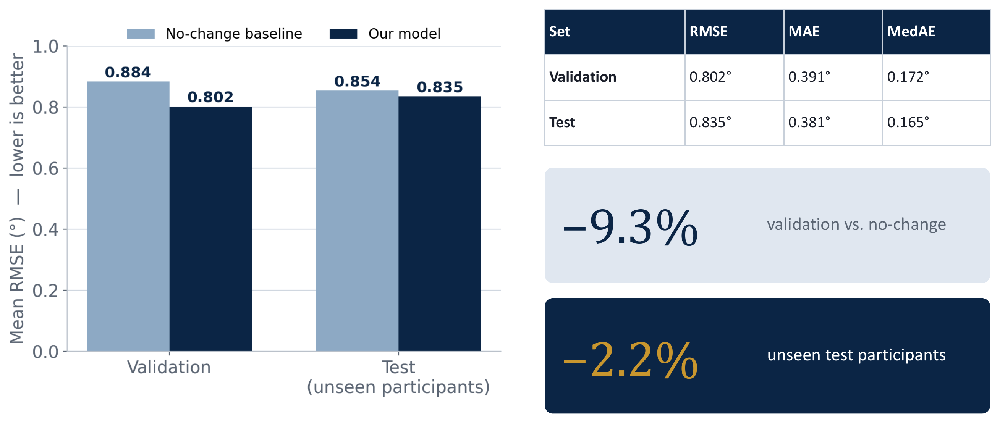
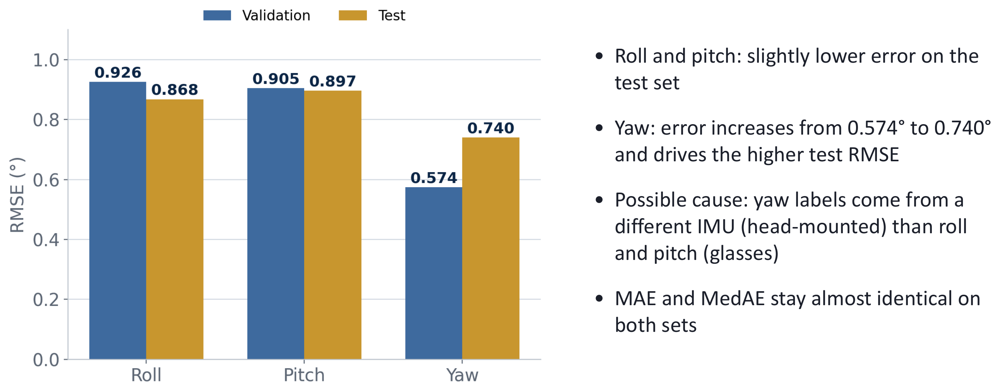

# Results

This folder contains the training history and the plots of every run in Chapter 5 of the thesis, and the test metrics that the scripts recorded. Model weights are not included. The weights of the final model will be provided as a GitHub Release asset (see the main [README](../README.md#pretrained-model)).

All files were written by the training scripts in [`training/experiments/`](../training/experiments/). Apart from the changes listed at the end, they are unchanged.

## Final model

The final configuration was retrained on the full participant-level split (26 / 6 / 6 recordings) and evaluated once on the test set of unseen participants (thesis Section 5.9, Table 21).



*Mean RMSE of the final model compared with the no-change reference, which assumes zero head motion between consecutive frames. Validation values come from `history.csv` (best epoch 5), test values from `experiments_summary.csv`.*



*RMSE per angle. Yaw is the only angle with a higher error on the test set.*

## Folder layout

The folders follow the order of [`training/experiments/`](../training/experiments/). Every run folder carries the name that its script writes, `<experiment>__<value>`.

```
results/
├── experiments_summary.csv
├── 01_loss_function/
│   └── Loss_Function__L1_Beta_0.1/
│       ├── history.csv
│       ├── plot_train_vs_val_loss.png
│       ├── plot_val_mean_rmse.png
│       ├── plot_val_mean_mae.png
│       └── plot_val_mean_medae.png
├── 02_imu_angle_aggregation/
├── ...
└── 08_final_model/
    └── Final_Full_Dataset__Final_Config_All_Recordings/
```

| File | Content |
|---|---|
| `history.csv` | One row per epoch: training and validation loss; MAE, RMSE and MedAE in degrees for roll, pitch, yaw and their mean, on the training and validation sets; learning rates of the backbone and of the rest of the model; epoch time in minutes. |
| `plot_train_vs_val_loss.png` | Training and validation loss per epoch. |
| `plot_val_mean_rmse.png`, `plot_val_mean_mae.png`, `plot_val_mean_medae.png` | Validation Mean RMSE, MAE and MedAE per epoch. |
| `experiments_summary.csv` | One row per run: best epoch, test loss, and test MAE, RMSE and MedAE per angle and mean. Each script appends its row after evaluating its best checkpoint on the test set. |

The loss curves of the runs selected in Chapter 5 are thesis Figures 7–12: `plot_train_vs_val_loss.png` of `Loss_Function__L1_Beta_0.1` (Figure 7), `IMU_Angle_Experiment__Window_31` (Figure 8), `Temporal_Context_Sweep__Past40_Future5` (Figure 9), `Batch_Size_Sweep__Batch12` (Figure 10), `Dropout_Sweep__1e-4_dropout02` (Figure 11) and `Weight_Decay_Sweep__wd_0` (Figure 12).

The best epoch is the epoch with the lowest validation loss. Training stopped when the validation loss did not improve for 4 epochs, so every history ends 4 epochs after the best epoch.

## Results of the experiments

All values are validation metrics in degrees at the best epoch, computed from the `history.csv` files, on the intermediate subset (9 / 2 / 2 recordings). Each block corresponds to one table of Chapter 5.

- The experiments are sequential (see [`training/README.md`](../training/README.md#how-the-experiments-were-run)).
- **(ref.)** marks the reference configuration of a block: the configuration selected in the previous block. It was not trained again, and the table gives the folder of its run. Block 1 has no previous block; its reference, the initial baseline with the Geodesic loss, was trained in this block.
- The configuration selected in each block is in **bold**. As in the thesis, configurations were compared by Mean RMSE first and then by Mean MAE and Mean MedAE. Where these differed by only 0.001°, the number of epochs to the best epoch and the model complexity were also taken into account. Sections 5.2–5.8 of the thesis give the reasoning for each block.
- The no-change reference on this validation set is a Mean RMSE of 0.845° (thesis Table 7).

| Experiment | Configuration | Run folder | Best epoch | RMSE roll | RMSE pitch | RMSE yaw | Mean RMSE | Mean MAE | Mean MedAE |
|---|---|---|---|---|---|---|---|---|---|
| 1. Loss function (Table 8) | Smooth L1, β = 0.05 | `Loss_Function__L1_Beta_0.05` | 3 | 1.220 | 1.194 | 0.124 | 0.846 | 0.555 | 0.315 |
|  | **Smooth L1, β = 0.1** | `Loss_Function__L1_Beta_0.1` | 6 | 1.223 | 1.194 | 0.123 | 0.846 | 0.553 | 0.314 |
|  | Geodesic (ref.) | `Loss_Function__Geodesic` | 6 | 1.129 | 1.077 | 0.514 | 0.906 | 0.470 | 0.210 |
| 2. IMU-angle aggregation (Table 9) | Nearest neighbour (ref.) | `Loss_Function__L1_Beta_0.1` | 6 | 1.223 | 1.194 | 0.123 | 0.846 | 0.553 | 0.314 |
|  | Window 11 | `IMU_Angle_Experiment__Window_11` | 15 | 1.128 | 1.077 | 0.514 | 0.906 | 0.470 | 0.210 |
|  | Window 21 | `IMU_Angle_Experiment__Window_21` | 9 | 1.009 | 0.972 | 0.385 | 0.789 | 0.411 | 0.169 |
|  | **Window 31** | `IMU_Angle_Experiment__Window_31` | 9 | 0.884 | 0.877 | 0.323 | 0.695 | 0.355 | 0.136 |
| 3. Temporal context (Table 10) | Past 10 / Future 0 | `Temporal_Context_Sweep__Past10_Future0` | 9 | 0.897 | 0.878 | 0.286 | 0.687 | 0.370 | 0.156 |
|  | Past 20 / Future 0 | `Temporal_Context_Sweep__Past20_Future0` | 3 | 0.888 | 0.890 | 0.323 | 0.700 | 0.375 | 0.161 |
|  | Past 20 / Future 5 (ref.) | `IMU_Angle_Experiment__Window_31` | 9 | 0.884 | 0.877 | 0.323 | 0.695 | 0.355 | 0.136 |
|  | **Past 40 / Future 5** | `Temporal_Context_Sweep__Past40_Future5` | 2 | 0.893 | 0.875 | 0.286 | 0.685 | 0.363 | 0.147 |
| 4. Batch size (Table 11) | **12** | `Batch_Size_Sweep__Batch12` | 5 | 0.891 | 0.877 | 0.285 | 0.684 | 0.358 | 0.138 |
|  | 24 (ref.) | `Temporal_Context_Sweep__Past40_Future5` | 2 | 0.893 | 0.875 | 0.286 | 0.685 | 0.363 | 0.147 |
| 5. Learning rate (Table 12) | 3e-5 | `LR_Sweep__AdamW_diffLR_base3e-5` | 4 | 0.898 | 0.877 | 0.285 | 0.687 | 0.367 | 0.152 |
|  | **1e-4 (ref.)** | `Batch_Size_Sweep__Batch12` | 5 | 0.891 | 0.877 | 0.285 | 0.684 | 0.358 | 0.138 |
|  | 2e-4 | `LR_Sweep__AdamW_diffLR_base2e-4` | 12 | 0.891 | 0.876 | 0.285 | 0.684 | 0.357 | 0.138 |
|  | 3e-4 | `LR_Sweep__AdamW_diffLR_base3e-4` | 16 | 0.891 | 0.876 | 0.285 | 0.684 | 0.357 | 0.138 |
| 6a. Dropout (Table 13) | 0.0 | `Dropout_Sweep__1e-4_dropout00` | 1 | 0.904 | 0.875 | 0.288 | 0.689 | 0.380 | 0.172 |
|  | 0.05 | `Dropout_Sweep__1e-4_dropout005` | 4 | 0.903 | 0.893 | 0.286 | 0.694 | 0.388 | 0.180 |
|  | 0.1 (ref.) | `Batch_Size_Sweep__Batch12` | 5 | 0.891 | 0.877 | 0.285 | 0.684 | 0.358 | 0.138 |
|  | **0.2** | `Dropout_Sweep__1e-4_dropout02` | 5 | 0.891 | 0.876 | 0.285 | 0.684 | 0.357 | 0.138 |
| 6b. Weight decay (Table 14) | **0** | `Weight_Decay_Sweep__wd_0` | 5 | 0.891 | 0.876 | 0.285 | 0.684 | 0.357 | 0.137 |
|  | 0.001 | `Weight_Decay_Sweep__wd_0001` | 5 | 0.891 | 0.876 | 0.285 | 0.684 | 0.357 | 0.138 |
|  | 0.01 (ref.) | `Dropout_Sweep__1e-4_dropout02` | 5 | 0.891 | 0.876 | 0.285 | 0.684 | 0.357 | 0.138 |
|  | 0.05 | `Weight_Decay_Sweep__wd_005` | 2 | 0.891 | 0.876 | 0.291 | 0.686 | 0.368 | 0.153 |
| 6c. Gradient clipping (Table 15) | None | `Gradient_Clipping_Sweep__gc_none` | 5 | 0.891 | 0.876 | 0.285 | 0.684 | 0.357 | 0.138 |
|  | 0.5 | `Gradient_Clipping_Sweep__gc_05` | 5 | 0.891 | 0.876 | 0.285 | 0.684 | 0.357 | 0.138 |
|  | **1.0 (ref.)** | `Weight_Decay_Sweep__wd_0` | 5 | 0.891 | 0.876 | 0.285 | 0.684 | 0.357 | 0.137 |
|  | 5.0 | `Gradient_Clipping_Sweep__gc_5` | 5 | 0.891 | 0.876 | 0.285 | 0.684 | 0.357 | 0.138 |
| 7a. Embedding dimension (Table 16) | 32 | `Architecture_Sweep__dmodel_32` | 14 | 0.891 | 0.876 | 0.285 | 0.684 | 0.357 | 0.138 |
|  | **64 (ref.)** | `Weight_Decay_Sweep__wd_0` | 5 | 0.891 | 0.876 | 0.285 | 0.684 | 0.357 | 0.137 |
|  | 128 | `Architecture_Sweep__dmodel_128` | 2 | 0.892 | 0.944 | 0.285 | 0.707 | 0.407 | 0.205 |
|  | 256 | `Architecture_Sweep__dmodel_256` | 14 | 0.892 | 0.876 | 0.285 | 0.684 | 0.357 | 0.138 |
| 7b. Encoder layers (Table 17) | 1 | `Architecture_Sweep__layers_1` | 1 | 0.896 | 0.877 | 0.286 | 0.686 | 0.366 | 0.151 |
|  | **2 (ref.)** | `Weight_Decay_Sweep__wd_0` | 5 | 0.891 | 0.876 | 0.285 | 0.684 | 0.357 | 0.137 |
|  | 3 | `Architecture_Sweep__layers_3` | 5 | 0.891 | 0.876 | 0.285 | 0.684 | 0.356 | 0.138 |
|  | 4 | `Architecture_Sweep__layers_4` | 5 | 0.891 | 0.877 | 0.285 | 0.684 | 0.357 | 0.138 |
| 7c. Attention heads (Table 18) | 2 | `Architecture_Sweep__head_2` | 7 | 0.892 | 0.881 | 0.285 | 0.686 | 0.364 | 0.144 |
|  | **4 (ref.)** | `Weight_Decay_Sweep__wd_0` | 5 | 0.891 | 0.876 | 0.285 | 0.684 | 0.357 | 0.137 |
|  | 8 | `Architecture_Sweep__head_8` | 1 | 0.894 | 0.876 | 0.288 | 0.686 | 0.366 | 0.151 |
| 7d. Feed-forward dimension (Table 19) | 256 | `Architecture_Sweep__ffn_256` | 9 | 0.901 | 0.876 | 0.286 | 0.687 | 0.370 | 0.156 |
|  | **512 (ref.)** | `Weight_Decay_Sweep__wd_0` | 5 | 0.891 | 0.876 | 0.285 | 0.684 | 0.357 | 0.137 |
|  | 1024 | `Architecture_Sweep__ffn_1024` | 26 | 0.891 | 0.876 | 0.285 | 0.684 | 0.356 | 0.137 |
|  | 2048 | `Architecture_Sweep__ffn_2048` | 3 | 0.892 | 0.878 | 0.285 | 0.685 | 0.359 | 0.139 |

The test columns of `experiments_summary.csv` for these runs refer to the 2 test recordings of the intermediate subset. Configurations were selected on the validation set only.

## Changes since the original files

- Two run folders were renamed to the name their scripts now write: `Temporal_Contect_Sweep__Past10_Future0` and `..._Past20_Future0` to `Temporal_Context_Sweep__...` (see [`training/README.md`](../training/README.md#changes-since-the-original-files)), and `Batch_Size_12` to `Batch_Size_Sweep__Batch12`, which is the name written by the batch-size script and used in `experiments_summary.csv`.
- The final run was launched a second time after it had stopped early at epoch 9. This second launch added one epoch (10) to the history and wrote the same test row to `experiments_summary.csv` again; the best model (epoch 5) was not affected. The extra epoch and the duplicate row were removed, and the four plots of this run were redrawn from the trimmed history with the plotting function of its script.
- Model checkpoints (`best_model.pth`, `last_checkpoint.pth`) and Jupyter backup copies were not included.
