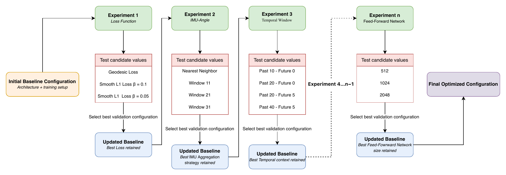
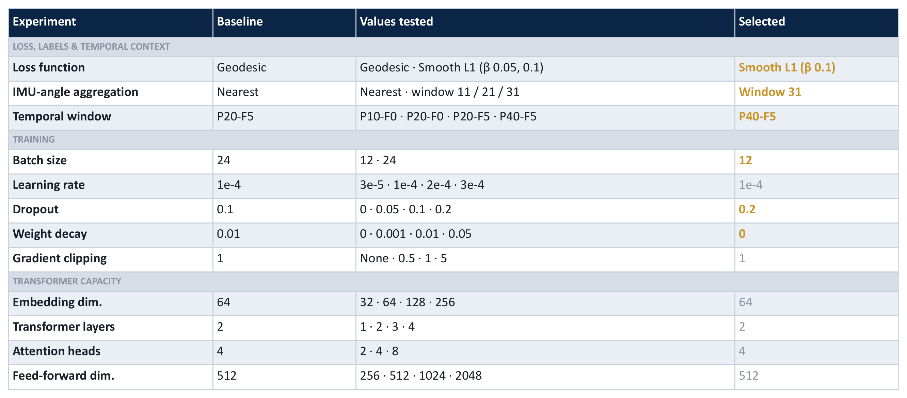

# Training

This folder contains the model, the dataset modules, the data splits and one training script per run of the experiments in Chapter 5 of the thesis. Thesis reference: Chapters 4 and 5.

All training ran on the **TU Wien dataLAB cluster** (SLURM, NVIDIA A100). Every training script has a SLURM launcher (`run_training_*.sh`) next to it, and every Python file starts with a docstring that describes its configuration, outputs and thesis section.

## Contents

| File | Purpose | Thesis |
|---|---|---|
| `model_resnet_transformer.py` | ResNet-50 + Transformer encoder (CLS token, sinusoidal positional encoding) + regression head | 4.2 |
| `dataset.py` | Nearest-neighbour (NN) labels: windows and targets from the `roll_nn`, `pitch_nn`, `yaw_nn` columns | 4.1, 4.4.2 |
| `dataset_win11.py` / `dataset_win21.py` / `dataset_win31.py` | The same for labels averaged over 11 / 21 / 31 IMU samples | 4.1, 4.4.3 |
| `create_fixed_split_preliminary.py` → `fixed_split.json` | Participant-level intermediate subset, 9 / 2 / 2 recordings | 4.3.2 |
| `create_final_split_full_dataset.py` → `final_split.json` | Participant-level final split, 26 / 6 / 6 recordings (extends the intermediate subset) | 4.3.3 |
| `inspect_recording_windows.py` → `recording_window_counts.csv` | Number of training windows per recording | 4.3 |
| `experiments/` | One folder per experiment, with one script and one launcher per run | 5.2–5.9 |

The target of every window is the orientation change between the previous and the current frame: Δroll / 180, Δpitch / 180, sin Δyaw and cos Δyaw.

## How the experiments were run

The experiments are **sequential**: each step varies one factor, and the configuration selected in a step is the reference of the next step. That reference was therefore not trained again; its run belongs to the previous step. For example, the Smooth L1 loss with β = 0.1 won the loss-function step, and this run (nearest-neighbour labels) is also the NN reference of the IMU-angle step.

All experiments use the intermediate subset (`fixed_split.json`). The final model was then retrained on the full split (`final_split.json`).



*Sequential refinement of the configuration (thesis Figure 6).*



*Baseline, tested values and selected value of each experiment.*

| Step | Folder | Section | Varied | Reference (run of the previous step) | Selected |
|---|---|---|---|---|---|
| 1 | `01_loss_function` | 5.2 | Geodesic, Smooth L1 β = 0.05, β = 0.1 | Geodesic (baseline configuration) | Smooth L1, β = 0.1 |
| 2 | `02_imu_angle_aggregation` | 5.3 | Window 11, 21, 31 | NN: `Loss_Function__L1_Beta_0.1` | Window 31 |
| 3 | `03_temporal_context` | 5.4 | Past 10 / Future 0, Past 20 / Future 0, Past 40 / Future 5 | Past 20 / Future 5: `IMU_Angle_Experiment__Window_31` | Past 40 / Future 5 |
| 4 | `04_batch_size` | 5.5 | 12 | 24: `Temporal_Context_Sweep__Past40_Future5` | 12 |
| 5 | `05_learning_rate` | 5.6 | 2e-4, 3e-4, 3e-5 | 1e-4: `Batch_Size_Sweep__Batch12` | 1e-4 |
| 6a | `06_regularization` | 5.7.1 | Dropout 0, 0.05, 0.2 | 0.1: `Batch_Size_Sweep__Batch12` | 0.2 |
| 6b | `06_regularization` | 5.7.2 | Weight decay 0, 0.001, 0.05 | 0.01: `Dropout_Sweep__1e-4_dropout02` | 0 |
| 6c | `06_regularization` | 5.7.3 | Gradient clipping 0.5, 5, none | 1.0: `Weight_Decay_Sweep__wd_0` | 1.0 |
| 7 | `07_transformer_capacity` | 5.8 | d_model 32 / 128 / 256, 1 / 3 / 4 layers, 2 / 8 heads, FFN 256 / 1024 / 2048 | d_model 64, 2 layers, 4 heads, FFN 512: `Weight_Decay_Sweep__wd_0` | the reference |
| 8 | `08_final_model` | 5.9 | Final configuration on the full split | – | – |

Notes on the table:

- **Step 3.** The Past 40 / Future 5 run uses batch size 8 with gradient accumulation over 3 steps, so its effective batch size is 24, the same as in all earlier runs.
- **Selection.** Configurations were compared on the validation set of the intermediate subset (thesis Chapter 5). Each script also evaluates its best checkpoint on the test set and appends the result to `runs/experiments_summary.csv`.

The per-run training histories and plots are in [`results/`](../results/).

## Running the scripts

On the cluster, all files were in one flat working directory, and the scripts use relative paths (`fixed_split.json`, `final_split.json`, `runs/`). To keep the code unchanged, run every script **from this folder** with the folder on the Python path:

```bash
cd training
PYTHONPATH=. python experiments/08_final_model/train_final_checkpoint.py
```

- The data path is the original path on the cluster (`BASE = "/share/e12507305/preprocessed/DERIVED_ET_IMU_head_mounted"`). It must contain the `paired_frames*.csv` files of preprocessing step 09 and the 512×512 frames of step 10 under `results/frames_512/`.
- Each run writes `best_model.pth`, `history.csv` and four plots to `runs/<experiment>__<value>/`.
- The SLURM launchers `cd` into the original working directory on the cluster and call the script by its file name.
- The Python packages can be installed with `uv sync --group training` (see the main [README](../README.md)). The data are not public (see the main [README](../README.md#data-availability)).

## Changes since the original files

The scripts were first committed exactly as they were on the cluster. They were then organized as follows:

- moved into one folder per experiment; the two split scripts renamed (`create_fixed_split.py`, `create_final_split.py`); a Greek capital Beta (Β) in the launcher names replaced by a Latin B;
- docstrings added to every Python file, and the Δ symbols in the model comments written out in English;
- the scripts of three runs were not among the saved files (`Batch_Size_Sweep__Batch12`, `LR_Sweep__AdamW_diffLR_base2e-4`, `Weight_Decay_Sweep__wd_0`), and `04_batch_size` held a copy of the Past 40 / Future 5 script. These scripts were recreated from the neighbouring script of the same experiment by changing only the varied setting and the run name. Their learning rate and weight decay agree with the optimizer state stored in the checkpoints of these runs;
- the run name `Temporal_Contect_Sweep` in the Past 10 / Future 0 and Past 20 / Future 0 scripts corrected to `Temporal_Context_Sweep`, as in the third script of the experiment and in `experiments_summary.csv`.

Apart from these changes, the executable code was not changed. This was verified by comparing the abstract syntax tree (AST) of every Python file before and after, with docstrings excluded, and the launchers byte by byte.
